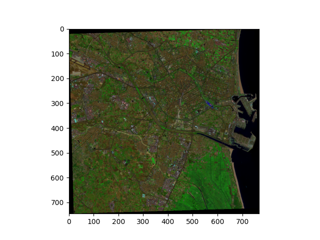
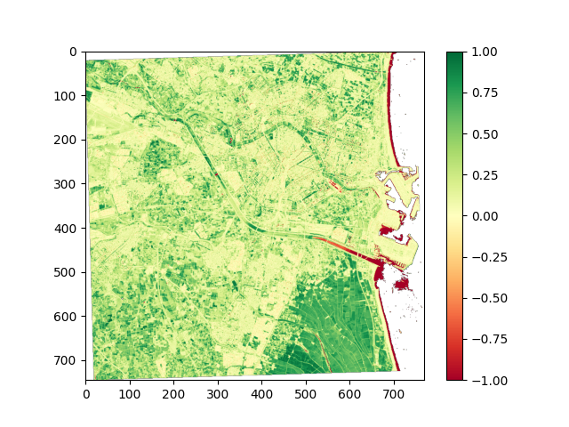
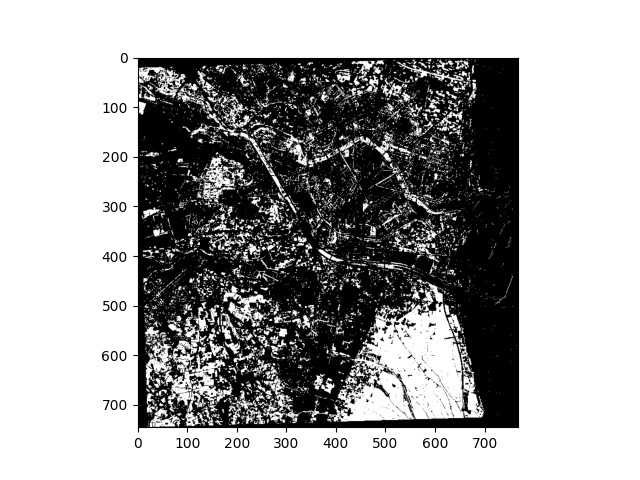

# Imagen digital

Aquí mostraré el resultado relevante del trabajo con una imagen RGB y una explicación breve del procedimiento.

# Sesión primera de imágenes por satélite.

Hemos trabajado con unas imágenes por satélite proporcionadas en la classroom.

El primer paso ha sido definir los diferentes colores (rojo, verde, azul, ir y swir) y posteriormente hemos obtenido imágenes a partir de la combinación de estos.

Después hemos definido con infrarojos (ir) y el color rojo (Así creando NDVI) a partir de la imagen anterior para definir el cambio de colores en diferentes zonas como las plantas, donde más se nota que es en la Albufera.

Por último hemos creado una máscara que a partir de 0,4 y de la imagen de arriba define las zonas usando el color gray.
