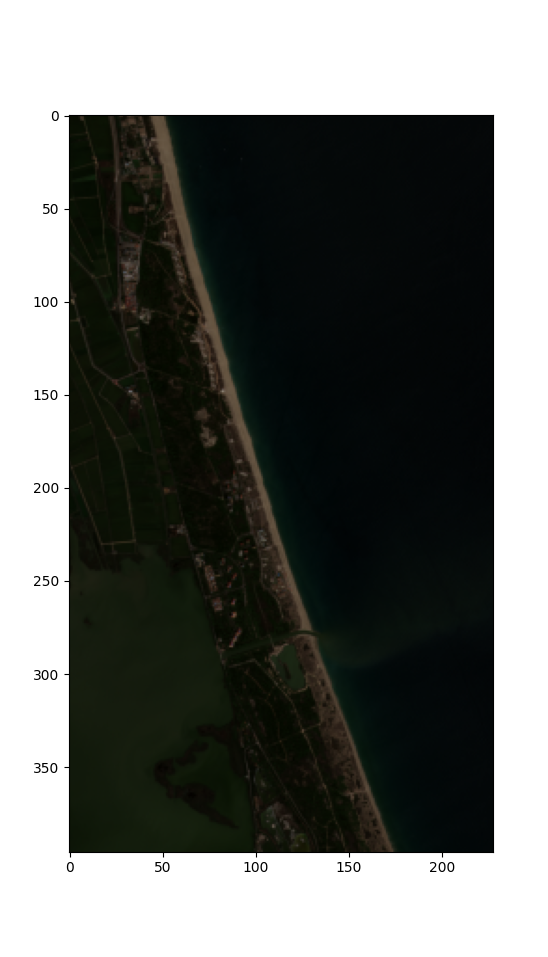
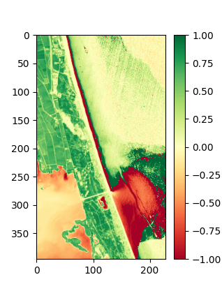
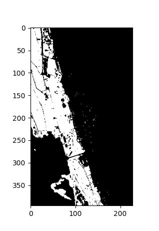
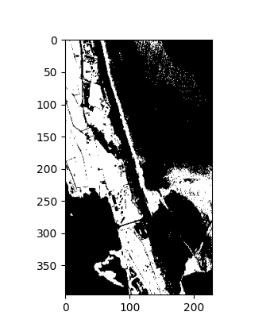
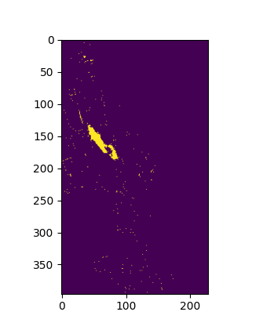
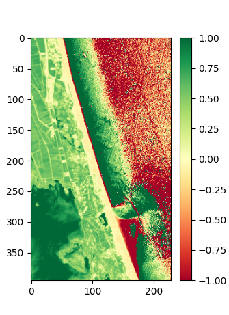
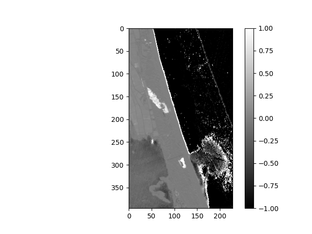
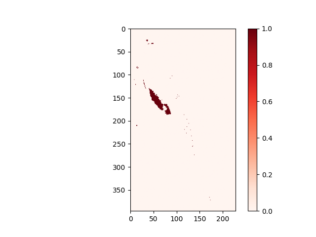
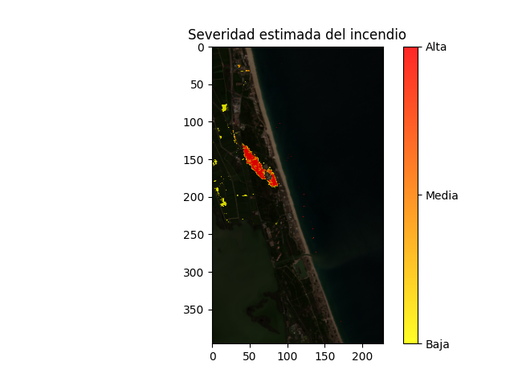
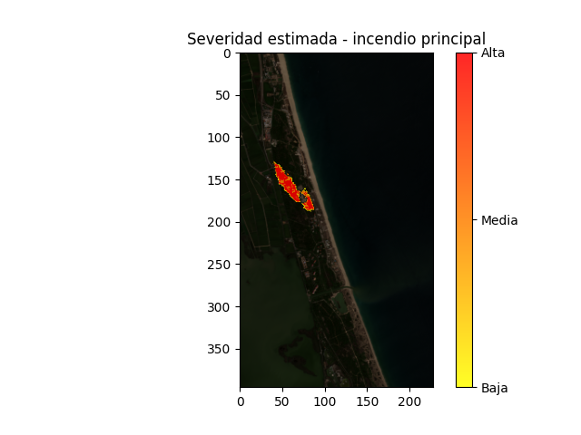

# Proyecto de incendio

Aquí documentaré la pregunta, los datos, el método, los resultados y las limitaciones del proyecto.

# Incendio Saler

En las últimas sesiones hemos trabajado con un código parecido, por no decir casi igual, al de la primera sesión de imágenes.
Entonces con las dos imágenes que nos proporcionaron empezamos a trabajar.

Después definimos las zonas verdes con el ndvi y yo también por mi propia cuenta hice la máscara de estas mismas.

Ahora empieza la dificultad de este reto, nos piden que distingamos la parte que ha sido incendiada, y despues sacar otra imagen con la diferencia.
Entonces para sacar la diferencia en la línea de código creo la variable "ndvi_dif", y creo la imagen con tonos rojos, y para la imagen de la zona quemada la variable "quemado".

Por último para sacar la imagen de la diferencia de la vegetación creo la variable nbr, que es la división del antes y después, y ahí doy por finalizado el reto.

O al menos eso creía porque faltaba hacer más cosas como primero arreglar mi nbr y crear otras imágenes, como la severidad, una representación del área afectada. Entonces creo otras imágenes  de diferencia de vegetación en grises y otra imágen que define la diferencia de nbr y ndvi en rojo.

Después para la severidad en un principio la calculo y con ello aparece una imagen que tiene defectos (unos píxeles sueltos que no forman parte del incendio y su área afectada).

Con esto intento solucionar el problema, creo una copia del código y con ella hago pruebas que concluyen en una imagen de la severidad más clara sin imperfecciones.

Y por último hago que calcule desde la terminal cuánta área ha sido afectada en hectáreas teniendo en cuenta esa diferencia que extraigo del área quemada y también de esta misma área sin aquellas imperfecciones, o islas, borradas:

El área calculada con NDVI es 20.60 ha

El área calculada con NBR es 32.32 ha

Área NBR sin islas: 29.28 ha