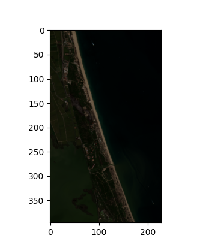
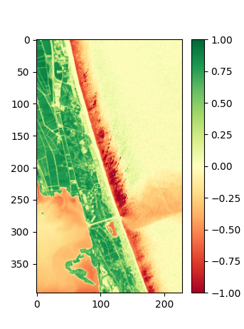
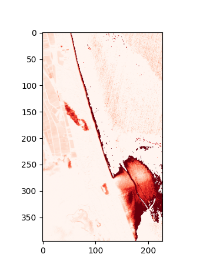

# Proyecto de incendio

Aquí documentaré la pregunta, los datos, el método, los resultados y las limitaciones del proyecto.

# Incendio Saler

En las últimas sesiones hemos trabajado con un código parecido, por no decir casi igual, al de la primera sesión de imágenes.
Entonces con las dos imágenes que nos proporcionaron empezamos a trabajar.

{: width="300px" }
{: width="300px" }

Después definimos las zonas verdes con el ndvi y yo también por mi propia cuenta hice la máscara de estas mismas.

{: width="300px" }
{: width="300px" }

Ahora empieza la dificultad de este reto, nos piden que distingamos la parte que ha sido incendiada, y despues sacar otra imagen con la diferencia.
Entonces para sacar la diferencia en la línea de código creo la variable "ndvi_dif", y creo la imagen con tonos rojos,y para la imagen de la zona quemada la variable "quemado".

{: width="300px" }
{: width="300px" }

Por último para sacar la imagen de la diferencia de la vegetación creo la variable nbr, que es la división del antes y después, y ahí doy por finalizado el reto.

(: width="300px")